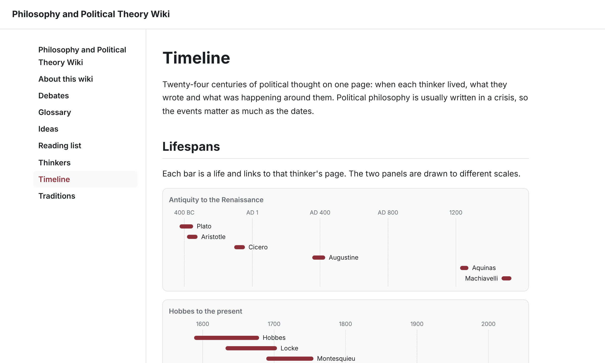
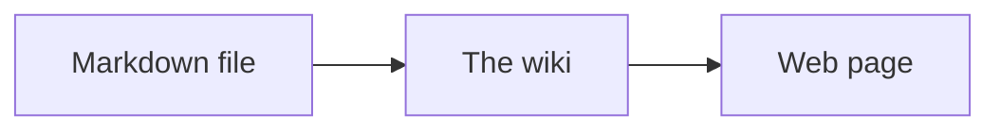

# Wikis

[](https://github.com/harlanljones/wikis/actions/workflows/ci.yml)
[](LICENSE)
[](LICENSE-CONTENT)

A collection of plain-language wikis, and the small engine that serves them. Each wiki is a folder of markdown files and a few lines of [Bun](https://bun.sh) server code. There is no framework, no database and no build step.

[](apps/california)

| Photography Wiki | Computer Parts Wiki | Philosophy and Political Theory Wiki |
| --- | --- | --- |
| [](apps/photography) | [](apps/computer-parts) | [](apps/philosophy) |

## The wikis

| Wiki | What it covers | Source | Local address |
| --- | --- | --- | --- |
| **California on Foot** | The geography and history behind a statewide California hike list: one reading per place, grouped by region, with a map of every one. | [`apps/california`](apps/california) | <http://localhost:3001> |
| **Computer Parts** | Choosing computer hardware: what each part does, what every spec means, and what to buy for a given budget or kind of work. | [`apps/computer-parts`](apps/computer-parts) | <http://localhost:3002> |
| **Photography** | Modern mirrorless and DSLR cameras: how exposure works, what the specs mean, how the camera systems differ, and how to choose a camera and lenses. | [`apps/photography`](apps/photography) | <http://localhost:3003> |
| **Philosophy and Political Theory** | Political philosophy through its thinkers, from Plato and Aristotle through Hobbes to Rawls: one page per thinker, plus the ideas, traditions and debates that connect them. | [`apps/philosophy`](apps/philosophy) | <http://localhost:3004> |
| **Example** | A small starter that shows how pages, sections, wiki links and diagrams work. Copy it to begin a new wiki. | [`apps/example`](apps/example) | <http://localhost:3000> |

The pages are ordinary markdown, so you can also read them on GitHub under each app's `content/` folder.

## What the engine does

Every wiki is built on `@wikis/core`, a small TypeScript package in this repo.

- **Markdown files are pages.** The file path is the URL, and the first heading is the title.
- **Wiki links.** `[[guides/linking]]` links to a page, and links to pages that do not exist yet are shown in a different color.
- **A sidebar of every page,** nested by folder, with light and dark themes that follow the reader's system setting.
- **Search.** A search box on every page finds pages by their text, with no index to build. See [Search](#search).
- **Diagrams.** A fenced `mermaid` code block is drawn as a diagram in the wiki's colors. See [Diagrams](#diagrams).
- **Search engine basics on every page:** a description, canonical link, Open Graph tags, a link preview image, breadcrumbs, a sitemap and a `robots.txt`. See [Search engines and link previews](#search-engines-and-link-previews).
- **Markdown for AI readers.** Every page is also served as plain markdown, and `/llms.txt` lists them all. See [Markdown for AI readers](#markdown-for-ai-readers).
- **Quick page changes.** Pages load ahead of the click and fade into each other, in browsers that support it.
- **Almost nothing beyond Bun.** Markdown is rendered by Bun's built-in parser and pages are served by `Bun.serve`. The one dependency is [Pele](https://pele.run), which draws the diagrams and has no dependencies of its own.

## Getting started

Install [Bun](https://bun.sh) (the version in `.bun-version`), then:

```sh
git clone https://github.com/harlanljones/wikis.git
cd wikis
bun install
bun run dev          # run every wiki, with hot reload
```

Each wiki is then running at the local address in the table above.

| Command                               | What it does                                    |
| ------------------------------------- | ----------------------------------------------- |
| `bun run dev`                         | Run every wiki with hot reload                  |
| `bun run --filter @wikis/example dev` | Run one wiki                                    |
| `bun run start`                       | Run every wiki in production mode               |
| `bun test`                            | Run the tests                                   |
| `bun run typecheck`                   | Type check the whole repo                       |
| `bun run new-wiki <name>`             | Create a new wiki app                           |
| `bun run cards [name...]`             | Draw each wiki's link preview image             |

## Layout

```
apps/
  example/            One wiki. Copy this shape for each new one.
    content/          Markdown pages. The file path is the URL.
    public/           Static files, served under /public/.
    src/server.ts     The Bun server for this wiki.
  california/         The other wikis follow the same shape.
  computer-parts/
  philosophy/
  photography/
packages/
  core/               @wikis/core: page loading, rendering, layout and SEO shared by every wiki.
scripts/
  new-wiki.ts         Scaffolds a new app under apps/.
  cards.ts            Draws each wiki's link preview image.
```

The repo uses [Bun workspaces](https://bun.sh/docs/install/workspaces). Apps depend on shared packages with `"@wikis/core": "workspace:*"`, and packages are imported as TypeScript source, so there is no build step.

## Adding a wiki

```sh
bun run new-wiki field-notes --title "Field Notes" --description "Notes from the field, in plain language."
bun run --filter @wikis/field-notes dev
```

This creates `apps/field-notes` with its own server and a starter home page. Each wiki gets its own default port, counting up from 3000. Pass `--port` to choose one, or set `PORT` when running it.

## Writing pages

Every markdown file in a wiki's `content/` directory is a page.

| File                        | URL                |
| --------------------------- | ------------------ |
| `content/index.md`          | `/`                |
| `content/getting-started.md`| `/getting-started` |
| `content/guides/index.md`   | `/guides`          |
| `content/guides/linking.md` | `/guides/linking`  |

- The first `# heading` is the page's title in the sidebar and browser tab.
- The first paragraph is the page's description in search results and link previews, so open each page with a sentence that sums it up.
- `[[getting-started]]` links to a page by its path, and `[[guides/linking|label]]` sets the link text. Capitals and spaces are ignored, so `[[Getting Started]]` is the same link. Links to pages that do not exist yet are shown in a different color.
- Inside a table, escape the pipe in a wiki link: `[[guides/linking\|label]]`.
- GitHub-flavored markdown (tables, task lists, strikethrough, autolinks) is supported through Bun's built-in `Bun.markdown` parser.
- A fenced code block marked `mermaid` is drawn as a diagram. See [Diagrams](#diagrams).
- Raw HTML in markdown is passed through as written, so only publish content you trust.

In development the content directory is read on every request, so edits appear on reload. With `NODE_ENV=production` the list of pages is read once at startup, so restart the server after adding or renaming pages.

## Diagrams

Write a diagram as text in [Mermaid](https://mermaid.js.org) syntax, inside a fenced code block marked `mermaid`:

````markdown

````

The wiki draws it with [Pele](https://pele.run) when the page is served and puts the picture straight into the page. Readers need no script, and the diagram takes its colors from the wiki, so it follows light and dark themes. Flowcharts, timelines, sequence diagrams and the other Mermaid types all work. The example wiki's [diagrams page](apps/example/content/guides/diagrams.md) shows a few.

A block that cannot be read is shown as code with the reason underneath. To catch that before publishing, copy the "every diagram can be drawn" test from [`apps/example/test`](apps/example/test/content.test.ts) into your wiki.

## Search

Every page has a search box in its header. It submits to `/search`, which lists the pages that contain every word typed, best match first, with the passage that matched and a link to the section it is in.

- A word in a page's title counts most, then a word in a heading, then how often it appears in the text.
- The start of a word matches, so `expos` finds `exposure`. Capitals and accents are ignored.
- When no page has every word, the pages with the most of them are shown instead.

Search runs on the server over the same markdown files, so there is no index to build and it works without JavaScript. A wiki with a page of its own at `content/search.md` keeps that page and goes without the search box.

## How a wiki app works

An app is a few lines. `createWiki` returns a request handler, and the app owns the server:

```ts
import { createWiki } from "@wikis/core";

const wiki = createWiki({
  title: "Example Wiki",
  description: "A starting point for a new wiki.", // optional, for search results
  contentDir: `${import.meta.dir}/../content`,
  publicDir: `${import.meta.dir}/../public`,
  accent: "#0f766e", // optional, any CSS color
});

Bun.serve({
  port: Number(Bun.env.PORT ?? 3000),
  fetch: wiki.fetch,
});
```

Because each app calls `Bun.serve` itself, a wiki can add its own endpoints with `routes` and let everything else fall through to `wiki.fetch`:

```ts
Bun.serve({
  routes: {
    "/api/hello": () => Response.json({ hello: "world" }),
  },
  fetch: wiki.fetch,
});
```

A wiki can also change the pages themselves. [`apps/california`](apps/california/src/wiki.ts) passes each response through Bun's `HTMLRewriter` to add its own stylesheet, fold the sidebar and draw its map, and [`apps/philosophy`](apps/philosophy/src/wiki.ts) does the same to draw its timeline.

Besides pages, every wiki serves `/search`, `/llms.txt`, each page's markdown at its address plus `.md`, `/assets/wiki.css` (the shared stylesheet), `/public/*` (the app's static files), `/sitemap.xml`, `/robots.txt`, `/favicon.svg` and `/healthz`.

## Search engines and link previews

Every wiki gets these without any setup:

| What | How it is filled in |
| --- | --- |
| `<title>` | The page's first heading, followed by the wiki's name |
| Meta description | The wiki's `description` on the home page, and each page's first paragraph elsewhere |
| Canonical link | The page's one true URL. Other spellings such as `/Getting Started/` redirect to it |
| Open Graph and Twitter tags | Title, description, URL and site name, so shared links show a preview card |
| Link preview image | `public/card.png`, the card that `bun run cards` draws from the wiki's title, description and accent color |
| Breadcrumbs | Schema.org data listing a page's parent sections, which search engines show in place of the URL |
| `/sitemap.xml` | Every page of the wiki |
| `/robots.txt` | Allows every crawler and points at the sitemap |
| `/favicon.svg` | The wiki's first letter on its accent color |

The 404 page is marked `noindex`, and links to pages that have not been written are marked `nofollow`.

Three options tune this:

| `createWiki` option | What it does |
| --- | --- |
| `description` | One or two sentences about the wiki, shown for the home page |
| `siteUrl` | The wiki's public address, such as `https://wiki.example.com`. Defaults to the `SITE_URL` environment variable |
| `image` | An image for link previews, as a path such as `/public/card.png` or a full URL. 1200 by 630 pixels suits most sites. Defaults to `public/card.png` when that file exists |

Set `SITE_URL` in production. Without it, the wiki works out its address from each request, including the `X-Forwarded-Proto` and `X-Forwarded-Host` headers that a reverse proxy sets, which is right for most hosts but not guaranteed.

To replace a built-in file, or to add a site verification file that a search console asks for, put it at the top of the app's `public/` folder. `public/robots.txt` is served at `/robots.txt`, `public/favicon.svg` at `/favicon.svg`, and so on.

### Link preview images

```sh
bun run cards               # every wiki
bun run cards photography   # one wiki
```

This draws a 1200 by 630 card for each wiki and saves it as `apps/<name>/public/card.png`, which the wiki then uses for every page. The cards are committed, so nothing is drawn when the wiki is served. Run the command again after changing a wiki's title, description, accent color or favicon.

[](apps/photography)

The card is a small web page photographed by `Bun.WebView`, the browser built into Bun, so there is nothing to install on macOS. On Linux and Windows it needs Chrome, Chromium, Edge or Brave. Link previews need a full address for the image, so set `SITE_URL` in production.

## Markdown for AI readers

AI assistants and other tools read markdown more easily than a web page, and the pages are markdown already. So every wiki serves:

| Address | What it is |
| --- | --- |
| `/guides/linking.md` | The markdown source of the page at `/guides/linking`. The home page is at `/index.md` |
| `/llms.txt` | An index of the whole wiki in the [llms.txt](https://llmstxt.org) layout: the title and description, then every page by section, each linking to its markdown with a one-line summary |

Each HTML page points at its markdown with a `<link rel="alternate" type="text/markdown">` tag, and each markdown response names the HTML page as the canonical one, so search engines keep listing the page that people should land on.

## Deploying

Each wiki is an independent server, so deploy them one at a time to any host that runs Bun:

```sh
bun install --production
SITE_URL=https://photography.example.com PORT=8080 bun run --filter @wikis/photography start
```

`/healthz` answers `ok` for health checks.

## Contributing

Corrections and new pages are welcome. See [CONTRIBUTING.md](CONTRIBUTING.md) for how to run the wikis, the writing conventions and the checks to run before opening a pull request.

## Credits

Thanks to [0xSero](https://x.com/0xSero) for the inspiration behind this project.

## License

- The code is released under the [MIT License](LICENSE).
- The wiki content, meaning everything under `apps/*/content/`, is released under [Creative Commons Attribution-ShareAlike 4.0](LICENSE-CONTENT). You may reuse and adapt it, including commercially, as long as you give credit and share your version under the same license.
