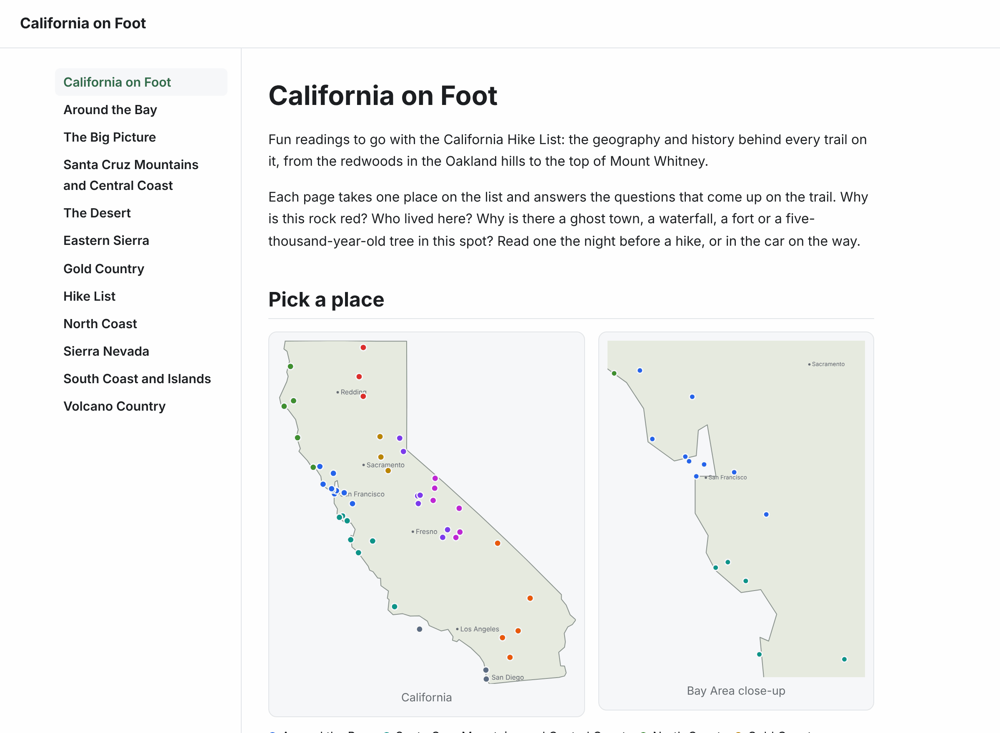
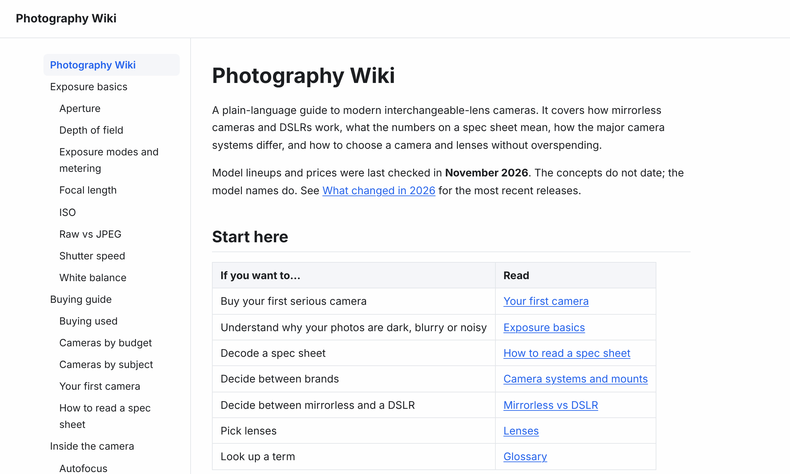

# Wikis

[](https://github.com/harlanljones/wikis/actions/workflows/ci.yml)
[](LICENSE)
[](LICENSE-CONTENT)

A collection of plain-language wikis, and the small engine that serves them. Each wiki is a folder of markdown files and a few lines of [Bun](https://bun.sh) server code. There is no framework, no database and no build step.

[](apps/california)

| Photography Wiki | Computer Parts Wiki |
| --- | --- |
| [](apps/photography) | [](apps/computer-parts) |

## The wikis

| Wiki | What it covers | Source | Local address |
| --- | --- | --- | --- |
| **California on Foot** | The geography and history behind a statewide California hike list: one reading per place, grouped by region, with a map of every one. | [`apps/california`](apps/california) | <http://localhost:3001> |
| **Computer Parts** | Choosing computer hardware: what each part does, what every spec means, and what to buy for a given budget or kind of work. | [`apps/computer-parts`](apps/computer-parts) | <http://localhost:3002> |
| **Photography** | Modern mirrorless and DSLR cameras: how exposure works, what the specs mean, how the camera systems differ, and how to choose a camera and lenses. | [`apps/photography`](apps/photography) | <http://localhost:3003> |
| **Example** | A four-page starter that shows how pages, sections and wiki links work. Copy it to begin a new wiki. | [`apps/example`](apps/example) | <http://localhost:3000> |

The pages are ordinary markdown, so you can also read them on GitHub under each app's `content/` folder.

## What the engine does

Every wiki is built on `@wikis/core`, a small TypeScript package in this repo.

- **Markdown files are pages.** The file path is the URL, and the first heading is the title.
- **Wiki links.** `[[guides/linking]]` links to a page, and links to pages that do not exist yet are shown in a different color.
- **A sidebar of every page,** nested by folder, with light and dark themes that follow the reader's system setting.
- **Search engine basics on every page:** a description, canonical link, Open Graph tags, breadcrumbs, a sitemap and a `robots.txt`. See [Search engines and link previews](#search-engines-and-link-previews).
- **No dependencies beyond Bun.** Markdown is rendered by Bun's built-in parser and pages are served by `Bun.serve`.

## Getting started

Install [Bun](https://bun.sh) (the version in `.bun-version`), then:

```sh
git clone https://github.com/harlanljones/wikis.git
cd wikis
bun install
bun run dev          # run every wiki, with hot reload
```

Each wiki is then running at the local address in the table above.

| Command                               | What it does                                    |
| ------------------------------------- | ----------------------------------------------- |
| `bun run dev`                         | Run every wiki with hot reload                  |
| `bun run --filter @wikis/example dev` | Run one wiki                                    |
| `bun run start`                       | Run every wiki in production mode               |
| `bun test`                            | Run the tests                                   |
| `bun run typecheck`                   | Type check the whole repo                       |
| `bun run new-wiki <name>`             | Create a new wiki app                           |

## Layout

```
apps/
  example/            One wiki. Copy this shape for each new one.
    content/          Markdown pages. The file path is the URL.
    public/           Static files, served under /public/.
    src/server.ts     The Bun server for this wiki.
  california/         The other wikis follow the same shape.
  computer-parts/
  photography/
packages/
  core/               @wikis/core: page loading, rendering, layout and SEO shared by every wiki.
scripts/
  new-wiki.ts         Scaffolds a new app under apps/.
```

The repo uses [Bun workspaces](https://bun.sh/docs/install/workspaces). Apps depend on shared packages with `"@wikis/core": "workspace:*"`, and packages are imported as TypeScript source, so there is no build step.

## Adding a wiki

```sh
bun run new-wiki field-notes --title "Field Notes" --description "Notes from the field, in plain language."
bun run --filter @wikis/field-notes dev
```

This creates `apps/field-notes` with its own server and a starter home page. Each wiki gets its own default port, counting up from 3000. Pass `--port` to choose one, or set `PORT` when running it.

## Writing pages

Every markdown file in a wiki's `content/` directory is a page.

| File                        | URL                |
| --------------------------- | ------------------ |
| `content/index.md`          | `/`                |
| `content/getting-started.md`| `/getting-started` |
| `content/guides/index.md`   | `/guides`          |
| `content/guides/linking.md` | `/guides/linking`  |

- The first `# heading` is the page's title in the sidebar and browser tab.
- The first paragraph is the page's description in search results and link previews, so open each page with a sentence that sums it up.
- `[[getting-started]]` links to a page by its path, and `[[guides/linking|label]]` sets the link text. Capitals and spaces are ignored, so `[[Getting Started]]` is the same link. Links to pages that do not exist yet are shown in a different color.
- Inside a table, escape the pipe in a wiki link: `[[guides/linking\|label]]`.
- GitHub-flavored markdown (tables, task lists, strikethrough, autolinks) is supported through Bun's built-in `Bun.markdown` parser.
- Raw HTML in markdown is passed through as written, so only publish content you trust.

In development the content directory is read on every request, so edits appear on reload. With `NODE_ENV=production` the list of pages is read once at startup, so restart the server after adding or renaming pages.

## How a wiki app works

An app is a few lines. `createWiki` returns a request handler, and the app owns the server:

```ts
import { createWiki } from "@wikis/core";

const wiki = createWiki({
  title: "Example Wiki",
  description: "A starting point for a new wiki.", // optional, for search results
  contentDir: `${import.meta.dir}/../content`,
  publicDir: `${import.meta.dir}/../public`,
  accent: "#0f766e", // optional, any CSS color
});

Bun.serve({
  port: Number(Bun.env.PORT ?? 3000),
  fetch: wiki.fetch,
});
```

Because each app calls `Bun.serve` itself, a wiki can add its own endpoints with `routes` and let everything else fall through to `wiki.fetch`:

```ts
Bun.serve({
  routes: {
    "/api/hello": () => Response.json({ hello: "world" }),
  },
  fetch: wiki.fetch,
});
```

A wiki can also change the pages themselves. [`apps/california`](apps/california/src/wiki.ts) passes each response through Bun's `HTMLRewriter` to add its own stylesheet, fold the sidebar and draw its map.

Besides pages, every wiki serves `/assets/wiki.css` (the shared stylesheet), `/public/*` (the app's static files), `/sitemap.xml`, `/robots.txt`, `/favicon.svg` and `/healthz`.

## Search engines and link previews

Every wiki gets these without any setup:

| What | How it is filled in |
| --- | --- |
| `<title>` | The page's first heading, followed by the wiki's name |
| Meta description | The wiki's `description` on the home page, and each page's first paragraph elsewhere |
| Canonical link | The page's one true URL. Other spellings such as `/Getting Started/` redirect to it |
| Open Graph and Twitter tags | Title, description, URL and site name, so shared links show a preview card |
| Breadcrumbs | Schema.org data listing a page's parent sections, which search engines show in place of the URL |
| `/sitemap.xml` | Every page of the wiki |
| `/robots.txt` | Allows every crawler and points at the sitemap |
| `/favicon.svg` | The wiki's first letter on its accent color |

The 404 page is marked `noindex`, and links to pages that have not been written are marked `nofollow`.

Three options tune this:

| `createWiki` option | What it does |
| --- | --- |
| `description` | One or two sentences about the wiki, shown for the home page |
| `siteUrl` | The wiki's public address, such as `https://wiki.example.com`. Defaults to the `SITE_URL` environment variable |
| `image` | An image for link previews, as a path such as `/public/card.png` or a full URL. 1200 by 630 pixels suits most sites |

Set `SITE_URL` in production. Without it, the wiki works out its address from each request, including the `X-Forwarded-Proto` and `X-Forwarded-Host` headers that a reverse proxy sets, which is right for most hosts but not guaranteed.

To replace a built-in file, or to add a site verification file that a search console asks for, put it at the top of the app's `public/` folder. `public/robots.txt` is served at `/robots.txt`, `public/favicon.svg` at `/favicon.svg`, and so on.

## Deploying

Each wiki is an independent server, so deploy them one at a time to any host that runs Bun:

```sh
bun install --production
SITE_URL=https://photography.example.com PORT=8080 bun run --filter @wikis/photography start
```

`/healthz` answers `ok` for health checks.

## Contributing

Corrections and new pages are welcome. See [CONTRIBUTING.md](CONTRIBUTING.md) for how to run the wikis, the writing conventions and the checks to run before opening a pull request.

## License

- The code is released under the [MIT License](LICENSE).
- The wiki content, meaning everything under `apps/*/content/`, is released under [Creative Commons Attribution-ShareAlike 4.0](LICENSE-CONTENT). You may reuse and adapt it, including commercially, as long as you give credit and share your version under the same license.
