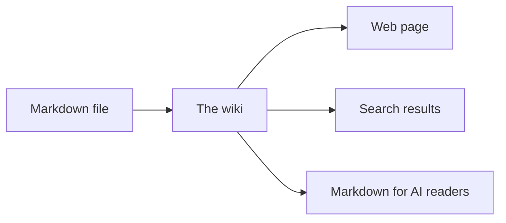
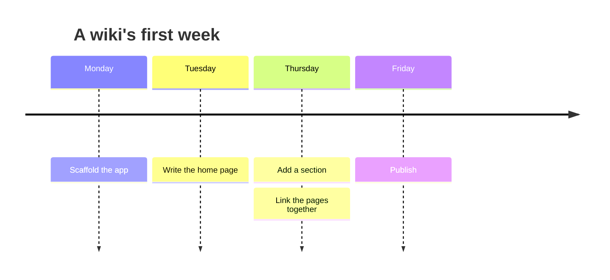
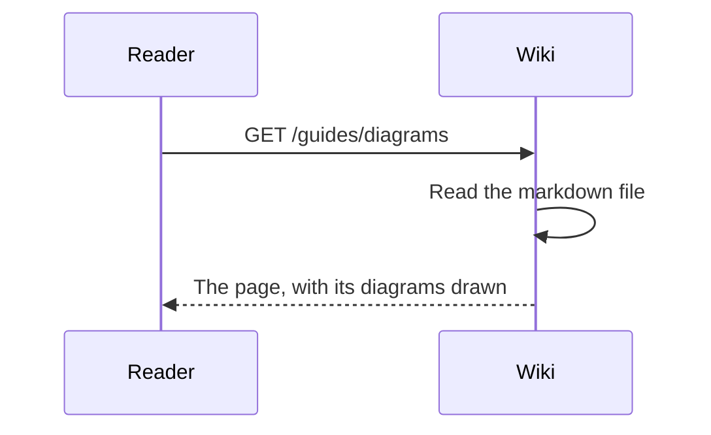

# Diagrams

A fenced code block marked `mermaid` is drawn as a diagram. The text is [Mermaid](https://mermaid.js.org) syntax, and the wiki turns it into a picture when the page is served, so readers need no script.

## A flowchart

Write this in a page:

````markdown

````

And it is shown as this:


Diagrams take their colors from the wiki, so they follow the reader's light or dark theme.

## Other kinds

Mermaid has many diagram types, and all of them work the same way. A timeline suits a history:



A sequence diagram suits a conversation between parts of a system:



## When a diagram is wrong

A block that cannot be read is shown as code, with the reason underneath, so a typo never takes the page down. This wiki's tests fail on a diagram that cannot be drawn, which catches the typo before it is published.

See [[guides/linking|Linking between pages]] for the other thing wikis add to markdown.
