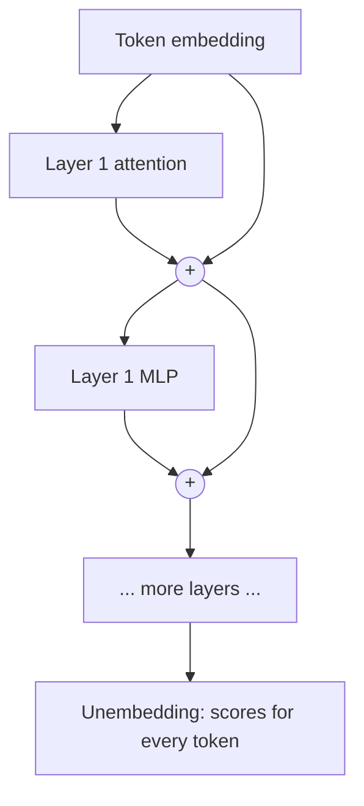

# Embeddings and the residual stream

Each token is turned into a long list of numbers (a vector), and that vector is passed up through every layer of the model, with each layer adding its own contribution to it.

## From token to vector

The model has an **embedding matrix** with one row per vocabulary entry. Token 374 (" is") is replaced by row 374: a vector of a few thousand numbers. In an 8B model it is typically 4,096 numbers long. That length is the model's **hidden size** or **model dimension**, often written *d*model.

These rows are learned in training. Tokens used in similar ways end up with similar vectors, which is why "embedding" is also used for vectors that represent meaning in search and retrieval systems.

## Directions carry meaning

A useful picture, which [[interpretability|interpretability]] research supports with caveats, is that **directions** in this space stand for concepts. A direction might roughly mean "plural", another "is a city", another "is in French". A vector is then a weighted sum of the concepts that apply.

The famous word2vec example (*king − man + woman ≈ queen*) is a simple case of this. In a large model the picture is much richer, and there are far more concepts than dimensions. See [[interpretability/superposition|Superposition]].

## The residual stream

Inside the model, each token position keeps one running vector. Every layer reads that vector, computes something, and **adds** its result back. Nothing overwrites it.

This running sum is called the **residual stream**, after the residual connections that make it. It matters for three reasons:

- **Training works.** Adding instead of replacing gives gradients a direct path from the output back to the early layers, which is what lets very deep networks train at all.
- **Layers communicate through it.** An early layer can write a fact into some direction, and a much later layer can read it, without the layers in between touching it.
- **It is what interpretability studies.** Most tools, from [[interpretability/probing|probes]] to [[interpretability/sparse-autoencoders|sparse autoencoders]], read the residual stream at some layer.

## Unembedding

At the top, a final normalization is applied and the vector is multiplied by the **unembedding matrix** (also called the output layer or LM head), giving one score per vocabulary entry. These raw scores are **logits**. A softmax turns them into probabilities, and [[fundamentals/sampling|sampling]] picks a token.

Some models reuse the embedding matrix as the unembedding (weight tying), which saves parameters. In small models with large vocabularies, these two matrices are a large share of the total. A 1B model with a 128,000-token vocabulary and a hidden size of 2,048 spends about 260 million parameters on one copy of the matrix.

Because the unembedding can be applied to the residual stream at any layer, you can ask what an intermediate layer "would predict". That trick is the [[interpretability/logit-lens|logit lens]].

## See also

- [[fundamentals/attention|Attention]], next on the reading path
- [[fundamentals/transformer|The transformer block]]
