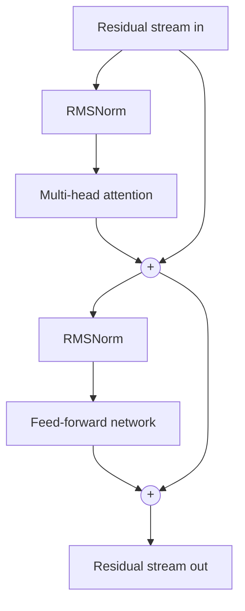

# The transformer block

A transformer is a stack of identical blocks, each of which runs attention (to move information between tokens) and then a feed-forward network (to process it at each token), both adding their results to the residual stream.

## One block

A current decoder-only model, such as those in the Llama, Qwen, Mistral or Gemma families, follows this shape:

1. **Normalize** the residual stream. Most modern models use RMSNorm, which rescales each vector to a standard size.
2. **Attention.** Each token gathers information from earlier tokens. See [[fundamentals/attention|Attention]].
3. **Add** the result to the residual stream.
4. **Normalize** again.
5. **Feed-forward network**, also called the MLP. It works on each token separately.
6. **Add** the result to the residual stream.

Putting the normalization before each part ("pre-norm") rather than after is the modern default because it trains more stably at depth.

## The feed-forward network

The MLP takes the hidden vector (say 4,096 numbers), expands it to a larger intermediate size (often about 3.5 times bigger, 14,336 in Llama 3 8B), applies a non-linear function, and projects it back down.

Most current models use a **gated** variant called **SwiGLU**: two up-projections are computed, one passes through the SiLU function and acts as a gate on the other, then the result is projected down. That is why model files list three matrices per MLP, usually named `gate`, `up` and `down`.

The MLP holds about two thirds of a dense model's parameters. Interpretability research suggests much factual recall happens in MLP layers, though "facts are stored in the MLPs" is a simplification. See [[interpretability/features-and-neurons|Features and neurons]].

## Counting parameters

For a dense model with hidden size *d*, intermediate size *f*, and *L* layers, ignoring small terms:

- Attention: about 4*d*² per layer with full multi-head attention, less with [[fundamentals/attention#Sharing keys and values: MQA, GQA and MLA|grouped-query attention]].
- SwiGLU MLP: 3*d* *f* per layer.
- Embeddings and output: vocabulary × *d*, once or twice.

Llama 3 8B: *d* = 4,096, *f* = 14,336, *L* = 32, 32 query heads and 8 KV heads, vocabulary 128,256. That gives roughly 1.3 billion for attention, 5.6 billion for the MLPs and 1 billion for the two embedding matrices, about 8 billion in all.

## Where the work goes

At generation time, every weight in the model is read once per token, and each weight is used for about two arithmetic operations (a multiply and an add). So generating one token with an 8B model is about 16 billion operations, but needs reading the whole 8B-parameter model from memory. Memory speed, not arithmetic, is usually the limit. See [[local/hardware|Hardware and memory]].

## Encoders, decoders and both

The original 2017 transformer had an **encoder** (which reads the input with no causal mask) and a **decoder** (which generates the output). BERT kept only the encoder and is used for classification and search embeddings. The GPT line kept only the decoder. Nearly every current chat model is decoder-only, and "transformer" in this wiki means a decoder-only model unless it says otherwise.

## See also

- [[fundamentals/positions|Position and RoPE]], next on the reading path
- [[fundamentals/mixture-of-experts|Mixture of experts]], which replaces the MLP with many smaller ones
