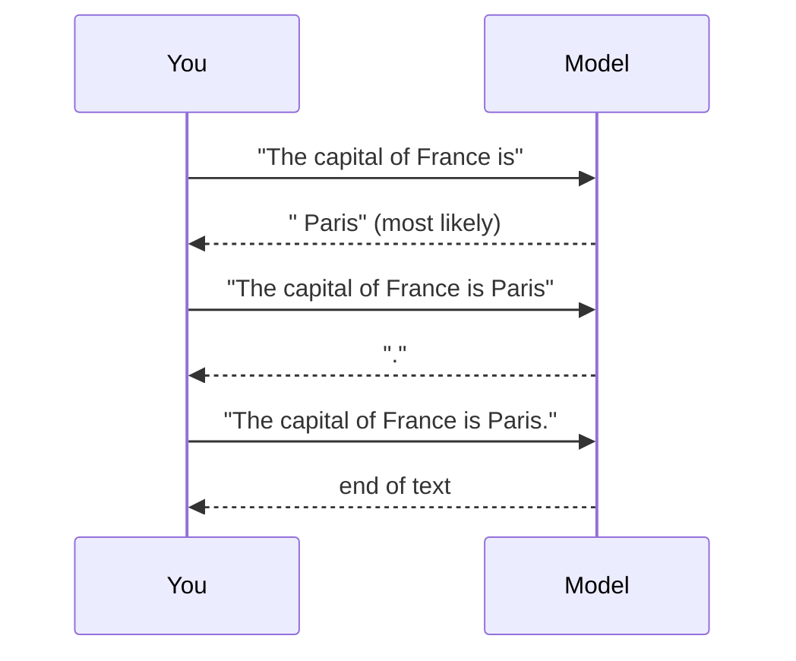

# What a language model is

A large language model is a function that takes a sequence of tokens and returns a probability for every possible next token, and everything it does comes from calling that function over and over.

## Next-token prediction

Give a model the text "The capital of France is" and it returns a score for each of the roughly 100,000 tokens in its vocabulary. " Paris" gets a high score, " a" and " the" get some, and " banana" gets almost none. Pick one, append it, and ask again. Repeat until the model produces an end-of-text token or you stop it.

That loop is called **autoregressive generation**. A chatbot answer of 500 words is about 650 calls to the model, each one producing one token.

## Why prediction leads to ability

To predict the next word of a physics textbook well, it helps to know physics. To predict the next line of a program, it helps to know what the program does. To predict what a character in a novel says next, it helps to model what they believe and want. Training pushes the model to build whatever internal machinery lowers its prediction error, and over trillions of tokens of varied text that machinery turns out to include grammar, facts, arithmetic, translation, coding and some forms of reasoning.

This is a description of what happens, not a guarantee. Models learn the patterns in their data, including errors and biases, and they can produce fluent text that is false. "Hallucination" is the usual name for a confident, fluent, wrong answer.

## Base models and assistants

A model straight out of [[training/pretraining|pretraining]] is a **base model**. It continues text. Ask it a question and it may answer, or it may write three more questions, because a list of questions is a plausible continuation.

An **instruct** or **chat** model has been through [[training/fine-tuning|fine-tuning]] and [[training/preference-tuning|preference tuning]] on conversations, so it answers in the voice of a helpful assistant. The underlying mechanism is the same: it is still predicting the next token, of a transcript in which an assistant replies.

Chat models expect their input in a particular layout called a **chat template**, with special tokens that mark where the system prompt, the user turns and the assistant turns begin and end. Running a chat model with the wrong template is a common cause of strange output when running models locally. See [[local/gguf|GGUF]] and [[local/llama-cpp|llama.cpp]].

## What "large" means

There is no fixed line. In practice:

| Size | Parameters | Example use |
| --- | --- | --- |
| Small | under 4B | Phones, autocomplete, simple classification |
| Medium | 7B to 14B | Capable assistants on one consumer graphics card |
| Large | 27B to 120B | Strong general and coding ability, workstation hardware |
| Frontier | hundreds of billions to trillions | Data-center models behind commercial services |

Many recent large models are [[fundamentals/mixture-of-experts|mixtures of experts]], which have a large total parameter count but use only a fraction of it for each token.

## What a model is on disk

A trained model is a set of named arrays of numbers (tensors), plus a config file describing the shape and a tokenizer file. A 7B model at 16-bit precision is about 14 GB. The same model in a [[quantization|quantized]] [[local/gguf|GGUF]] file at about 4.5 bits per weight is about 4.5 GB.

There is no database of facts or sentences inside. Everything the model "knows" is spread across those numbers. How it is spread is the subject of [[interpretability|interpretability]].

## See also

- [[fundamentals/tokens|Tokens and tokenizers]], next on the reading path
- [[history|A short history]]
