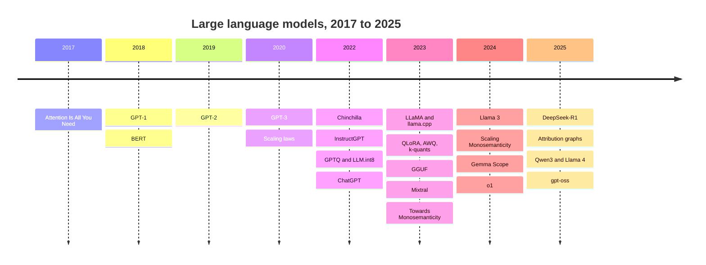

# A short history

From the transformer paper in 2017 to models you can run at home, in the events that shaped each part of this wiki. Dates are month and year of first public release.

## Foundations, 2017 to 2021

| When | Event | See |
| --- | --- | --- |
| June 2017 | *Attention Is All You Need* (Vaswani and others, Google) introduces the transformer | [[fundamentals/transformer\|The transformer block]] |
| June 2018 | OpenAI's GPT-1 shows that generative pretraining then fine-tuning works | [[training/pretraining\|Pretraining]] |
| October 2018 | Google's BERT, an encoder-only transformer, transforms language understanding benchmarks | |
| February 2019 | GPT-2 (1.5B parameters), released in stages over concerns about misuse | |
| January 2020 | Kaplan and others publish neural scaling laws | [[fundamentals/scaling-laws\|Scaling laws]] |
| May 2020 | GPT-3 (175B) shows few-shot learning from the prompt alone | |
| March 2020 to 2021 | *Zoom In* and the circuits essays on vision models. RoPE (2021). LoRA (2021) | [[interpretability/circuits\|Circuits]] |
| December 2021 | *A Mathematical Framework for Transformer Circuits* | [[interpretability/attention-heads\|Attention heads]] |

## The assistant era, 2022 to 2023

| When | Event | See |
| --- | --- | --- |
| March 2022 | Chinchilla rewrites compute-optimal training. InstructGPT describes RLHF. *Induction heads* paper | [[training/preference-tuning\|Preference tuning]] |
| August 2022 | LLM.int8() | [[quantization/int8\|8-bit quantization]] |
| September 2022 | *Toy Models of Superposition* | [[interpretability/superposition\|Superposition]] |
| October 2022 | GPTQ | [[quantization/gptq\|GPTQ]] |
| November 2022 | ChatGPT. SmoothQuant. The IOI circuit in GPT-2 small | [[interpretability/circuits\|Circuits]] |
| February 2023 | Meta's LLaMA weights reach researchers and then the public | |
| March 2023 | llama.cpp runs LLaMA on a laptop | [[local/llama-cpp\|llama.cpp]] |
| May 2023 | QLoRA. DPO | [[training/lora\|LoRA and QLoRA]] |
| June 2023 | AWQ. k-quants in llama.cpp | [[quantization/k-quants\|k-quants]] |
| July 2023 | Llama 2, with a licence permitting commercial use. Ollama appears around this time | [[local/ollama\|Ollama]] |
| August 2023 | GGUF replaces the GGML file format | [[local/gguf\|GGUF]] |
| September 2023 | Mistral 7B | |
| October 2023 | *Towards Monosemanticity* | [[interpretability/sparse-autoencoders\|Sparse autoencoders]] |
| December 2023 | Mixtral 8x7B popularises open mixture-of-experts models | [[fundamentals/mixture-of-experts\|Mixture of experts]] |

## Scale and reasoning, 2024 to 2025

| When | Event | See |
| --- | --- | --- |
| Early 2024 | i-quants and importance matrices in llama.cpp. BitNet b1.58 | [[quantization/other-methods\|Other methods]] |
| April 2024 | Llama 3 | |
| May 2024 | *Scaling Monosemanticity* and Golden Gate Claude | [[interpretability/sparse-autoencoders\|Sparse autoencoders]] |
| June to August 2024 | OpenAI's GPT-4 SAEs. Llama 3.1 405B. Gemma Scope | |
| September 2024 | OpenAI's o1, the first widely used reasoning model | [[training/reasoning\|Reasoning models]] |
| December 2024 | DeepSeek-V3 | |
| January 2025 | DeepSeek-R1, open weights and a published recipe for reasoning by reinforcement learning, with distilled small models | [[training/distillation\|Distillation]] |
| March 2025 | Anthropic's attribution graphs. Gemma 3 | [[interpretability/attribution-graphs\|Attribution graphs]] |
| April 2025 | Qwen3, Llama 4 and Gemma 3 QAT checkpoints | |
| August 2025 | OpenAI's gpt-oss, open-weight reasoning models in MXFP4 | [[quantization/other-methods#Microscaling formats: MXFP4 and NVFP4\|MXFP4]] |

## Since then

Open-weight releases have come every few weeks from many labs, mostly mixture-of-experts models with reasoning modes and long contexts. This wiki does not try to track each release. [[local/choosing-a-model|Choosing a model]] lists the families to watch.
