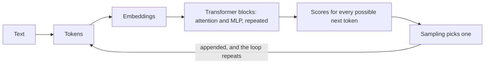

# LLM Wiki

A plain-language guide to large language models: how they turn text into numbers and back, how they are trained, how to run them on your own computer, how quantization shrinks them to fit, and what researchers have found by looking inside them.

It is written to be read in two ways. Every page opens with a one-sentence answer and the ideas you need to use it. Keep reading past that for the mechanics, the arithmetic and the research behind it.

## Where to start

**I want to understand how a language model works.**
Start at [[fundamentals|How LLMs work]] and follow the "Next" links at the bottom of each page. Ten short pages take you from [[fundamentals/tokens|tokens]] through [[fundamentals/attention|attention]] and the [[fundamentals/transformer|transformer]] to [[fundamentals/scaling-laws|scaling laws]].

**I want to run a model on my own computer.**
Go to [[local|Running models locally]]. The [[local/hardware|hardware page]] has a calculator for how much memory a model needs, and [[local/llama-cpp|llama.cpp]] and [[local/ollama|Ollama]] get you from nothing to a running model.

**I keep seeing Q4_K_M, AWQ and GPTQ and want to know which to pick.**
Read [[quantization|Quantization]], then [[quantization/k-quants|k-quants]] and [[quantization/choosing|choosing a quantization]].

**I want to know what is going on inside the model.**
[[interpretability|Interpretability]] covers [[interpretability/superposition|superposition]], [[interpretability/probing|probing]], [[interpretability/sparse-autoencoders|sparse autoencoders]], [[interpretability/circuits|circuits]] and [[interpretability/attribution-graphs|attribution graphs]].

## The whole subject on one page

1. **Text becomes tokens.** A [[fundamentals/tokens|tokenizer]] splits text into pieces from a fixed vocabulary of tens of thousands of entries, and each piece becomes an [[fundamentals/embeddings|embedding]], a list of a few thousand numbers.
2. **Layers refine the numbers.** Dozens of [[fundamentals/transformer|transformer blocks]] each let every token gather information from earlier tokens through [[fundamentals/attention|attention]], then process it in a feed-forward network. The running vector for each token is called the residual stream.
3. **The last layer scores every possible next token,** and [[fundamentals/sampling|sampling]] picks one. The new token is appended and the whole thing runs again. That loop is all text generation is.
4. **Training sets the numbers.** [[training/pretraining|Pretraining]] on trillions of tokens of text teaches the model to predict the next token. [[training/fine-tuning|Fine-tuning]] and [[training/preference-tuning|preference tuning]] turn that predictor into an assistant.
5. **Running a model is mostly moving memory.** Each generated token reads every active weight once, so speed is set by [[local/hardware|memory bandwidth]] and what fits is set by memory size. That is why [[quantization|quantization]] matters so much locally.
6. **The numbers are not readable by default.** Models store more concepts than they have neurons ([[interpretability/superposition|superposition]]), so interpretability research builds tools to pull the concepts back out.

## The 60-second version for running models at home

| You have | You can comfortably run | Start with |
| --- | --- | --- |
| A laptop with 16 GB of memory and no graphics card | 3B to 8B models at 4-bit, a few words a second | [[local/ollama\|Ollama]] |
| A graphics card with 8 to 12 GB | 7B to 14B models at 4-bit, fast | [[local/llama-cpp\|llama.cpp]] or Ollama |
| A graphics card with 16 to 24 GB | Up to about 32B dense models at 4-bit, or mid-sized mixture-of-experts models | llama.cpp with [[quantization/k-quants\|Q4_K_M]] |
| A Mac with 64 GB or more | 70B dense models, or large mixture-of-experts models | llama.cpp or [[local/other-tools\|MLX]] |
| Two or more large cards | 70B and up at higher precision | llama.cpp, or [[local/serving\|vLLM]] for many users |

Three rules hold almost everywhere:

- **Memory decides what fits, bandwidth decides how fast.** See [[local/hardware|Hardware and memory]].
- **A bigger model at 4 bits usually beats a smaller one at 8 bits** for the same memory. See [[quantization/choosing|Choosing a quantization]].
- **Context costs memory too.** A long conversation can need several gigabytes of [[fundamentals/kv-cache|KV cache]] on top of the weights.

## The rest of the wiki

- [[history|A short history]] runs from the transformer paper in 2017 to now.
- The [[glossary|Glossary]] defines every term in a sentence or two.
- The [[reading-list|Reading list]] gives the papers each page is built on.
- [[about|About this wiki]] says what it covers, what it leaves out, and how far to trust it.

Links in a different color point to pages that have not been written yet.
