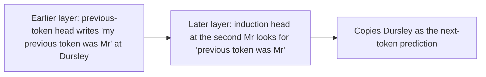

# Attention heads and induction

Individual attention heads often do recognisable jobs, such as looking at the previous token or copying a name seen earlier, and a two-head pattern called an induction head explains much of how models learn from examples in their prompt.

## Reading a head

Each head has two parts that can be studied separately, as set out in Anthropic's 2021 *Mathematical Framework for Transformer Circuits*:

- The **QK circuit** decides **where** the head looks: which earlier tokens score highly for the current one. Its result is the attention pattern, which can be shown as a grid.
- The **OV circuit** decides **what** it moves: given the tokens it attends to, what it writes into the residual stream.

Looking at attention patterns over many inputs is the quickest way to guess a head's job.

## Common kinds of head

| Head | Attends to | Does |
| --- | --- | --- |
| Previous-token head | The token just before | Copies information about it, so the next layer knows "what came before me" |
| Duplicate-token head | Earlier copies of the current token | Signals that a token has appeared before |
| Induction head | The token **after** an earlier copy of the current token | Predicts that what followed before will follow again |
| Name mover head | A name in the context | Copies it to the output, in tasks like [[interpretability/circuits#Indirect object identification\|indirect object identification]] |
| Attention sink | The first token, or a separator | "Parks" attention when the head has nothing useful to do |

## Induction heads

Take the text "...Mr Dursley ... Mr", where "Mr" has appeared before, followed by "Dursley". An induction head at the second "Mr" looks back for an earlier "Mr", attends to the token that came right after it ("Dursley"), and copies it as the prediction.

It takes two heads in different layers working together:

This is a simple, general algorithm: **"if A was followed by B before, predict B after A now."** It works for names, for code variable names, and for any repeated pattern, including made-up tokens the model has never seen.

## Induction heads and in-context learning

Anthropic's 2022 paper *In-context Learning and Induction Heads* (Olsson and others) found that, early in training, models of every size undergo a sudden change: induction heads form, and at the same moment the model gets much better at using earlier parts of its context to predict later parts. The loss curve shows a visible bump. Several lines of evidence suggest induction heads, and more abstract versions of them in larger models, are an important mechanism behind in-context learning.

## Attention sinks

Many heads put a large share of their attention on the first token, whatever it is. This seems to be how a head does "nothing": softmax weights must add up to one, so a head with nothing relevant to attend to parks its attention on a token whose value contributes little. Streaming methods that drop old tokens from the [[fundamentals/kv-cache|KV cache]] work far better if they keep the first few tokens, for this reason.

## See also

- [[interpretability/activation-patching|Activation patching]], next on the reading path
- [[fundamentals/attention|Attention]]
