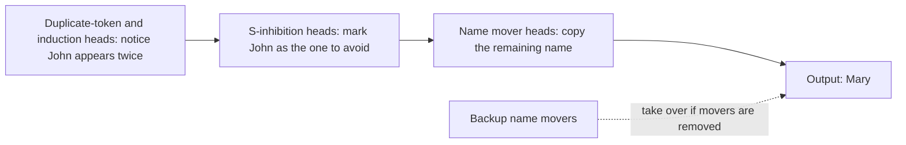

# Circuits

A circuit is a small part of a model, a set of components and the connections between them, that carries out one identifiable task, and finding circuits is the core of mechanistic interpretability.

## The idea

The circuits programme began in vision models with the *Zoom In* essays (Olah and others, 2020), which argued that networks are made of meaningful features joined by meaningful weights, and that these can be studied like biology: find a feature, see what feeds it and what it feeds.

For transformers, a circuit is usually described as a graph: attention heads, MLP layers or [[interpretability/sparse-autoencoders|features]] as nodes, and the paths through the residual stream between them as edges.

## Indirect object identification

The best-known circuit in a language model. Given "When Mary and John went to the store, John gave a drink to", GPT-2 small predicts " Mary": the name that was **not** repeated.

Wang and others (2022) used [[interpretability/activation-patching|path patching]] to find a circuit of 26 attention heads in GPT-2 small, in several groups:

The paper also found **backup** heads that take over when the main ones are knocked out, and **negative** heads that push against the answer, a sign that real circuits are messier than a clean diagram.

## Other circuits

- **Induction heads,** the two-head circuit for copying repeated patterns. See [[interpretability/attention-heads|Attention heads and induction]].
- **Greater-than** (Hanna and others, 2023): how GPT-2 completes "The war lasted from 1732 to 17" with a year above 32.
- **Modular addition:** in small models trained on addition modulo a prime, Nanda and others (2023) found the model converts numbers to rotations, uses trigonometric identities and reads off the answer. They used this to explain **grokking**, the sudden generalisation after long training.
- **Factual recall:** subject information is enriched by mid-layer MLPs and then extracted by attention heads at the final position.

## Automating discovery

Finding circuits by hand takes weeks per behaviour. **ACDC** (Conmy and others, 2023) automates it by pruning edges whose removal does not change the output. **Edge attribution patching** speeds this up with gradients. **[[interpretability/attribution-graphs|Attribution graphs]]** (2025) go further, tracing the circuit for a single prompt through interpretable features in one pass.

## How complete is a circuit?

A circuit is judged by **faithfulness** (does running only the circuit reproduce the behaviour?), **completeness** (is anything important missing?) and **minimality** (is anything unnecessary?). Published circuits typically explain a large part of the behaviour on the chosen prompts, not all of it, and they are found for narrow, well-chosen tasks. How well the approach scales to everything a frontier model does is an [[interpretability/open-problems|open question]].

## See also

- [[interpretability/sparse-autoencoders|Sparse autoencoders]], next on the reading path
