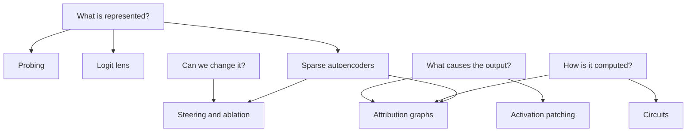

# Interpretability

Interpretability is the study of what goes on inside a trained model: which concepts it represents, where, and how it combines them to produce an answer. This section covers the main ideas and tools, from looking at single neurons to tracing whole circuits.

## Why it is hard

A model is billions of numbers set by training, not by a programmer. There are no labelled variables. Worse, single neurons rarely mean one thing: a neuron might fire for French text, for legal citations and for the colour red. The leading explanation is [[interpretability/superposition|superposition]]: models store many more concepts than they have neurons, as overlapping directions.

So most modern work tries first to find the right **units** (directions, called **features**), and then to find how features connect (**circuits**).

## Two broad approaches

- **Representation-level** work asks what information is present and where. [[interpretability/probing|Probes]], the [[interpretability/logit-lens|logit lens]] and [[interpretability/steering|steering vectors]] belong here. They are cheap and practical, and they say little about mechanism.
- **Mechanistic** work asks how the computation is done, step by step. [[interpretability/activation-patching|Activation patching]], [[interpretability/circuits|circuits]], [[interpretability/sparse-autoencoders|sparse autoencoders]] and [[interpretability/attribution-graphs|attribution graphs]] belong here.

## Pages

| Page | What it covers |
| --- | --- |
| [[interpretability/features-and-neurons\|Features and neurons]] | What a "feature" is, and why neurons are the wrong unit |
| [[interpretability/superposition\|Superposition]] | How a model packs more features than dimensions, and the toy models that show it |
| [[interpretability/probing\|Probing]] | Training simple classifiers to read information out of activations |
| [[interpretability/logit-lens\|The logit lens]] | Reading off what each layer would predict |
| [[interpretability/attention-heads\|Attention heads and induction]] | What individual heads do, and the induction heads behind in-context learning |
| [[interpretability/activation-patching\|Activation patching]] | Swapping activations between runs to find what causes what |
| [[interpretability/circuits\|Circuits]] | Subgraphs of the model that carry out a specific task, such as indirect object identification |
| [[interpretability/sparse-autoencoders\|Sparse autoencoders]] | Learning a large dictionary of interpretable features from activations |
| [[interpretability/attribution-graphs\|Transcoders and attribution graphs]] | Replacing the model's MLPs with interpretable parts and tracing a whole answer |
| [[interpretability/steering\|Steering]] | Adding or removing directions to change behaviour, including refusal and abliteration |
| [[interpretability/tools\|Tools]] | TransformerLens, nnsight, SAELens, Neuronpedia and doing this on your own computer |
| [[interpretability/open-problems\|Open problems]] | What does not work yet, and how far to trust the findings |

## A map of the methods

