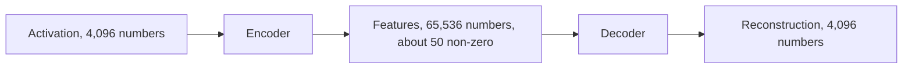

# Sparse autoencoders

A sparse autoencoder (SAE) learns a large dictionary of directions such that each activation can be rebuilt from only a few of them, and those directions turn out to be far more interpretable than neurons.

## The idea

If a layer's activations are [[interpretability/superposition|sparse combinations of many feature directions]], then we should be able to learn those directions. An SAE is a small network trained on saved activations from one layer:

1. **Encoder:** multiply the activation by a matrix and apply a non-linearity, giving a vector of feature activations that is much **wider** than the input (often 8 to 256 times) and mostly zeros.
2. **Decoder:** multiply back by another matrix to reconstruct the original activation. Each column of the decoder is one feature's direction.
3. **Training loss:** reconstruction error, plus a penalty that pushes most feature activations to zero (an L1 penalty, or a hard limit on how many can be active).

After training, each feature can be labelled by looking at the inputs that activate it most strongly, often automatically by having a language model read examples and write a description.

## Milestones

- **2023:** *Towards Monosemanticity* (Anthropic, Bricken and others) trained SAEs on a one-layer transformer and found thousands of clean features, such as Arabic script, DNA and base64. Cunningham and others independently showed SAEs finding interpretable features in Pythia models.
- **May 2024:** *Scaling Monosemanticity* (Anthropic) trained SAEs with up to about 34 million features on Claude 3 Sonnet. Features were abstract and multilingual and multimodal: one for the Golden Gate Bridge responded to the name in many languages and to pictures of it. Clamping it high produced "Golden Gate Claude", which brought the bridge into every answer. Features for deception, sycophancy, unsafe code and bias were found as well.
- **June 2024:** OpenAI (Gao and others) trained a 16-million-latent SAE on GPT-4 and introduced **TopK** SAEs, which keep exactly *k* features active, giving cleaner scaling laws for SAEs themselves.
- **August 2024:** Google DeepMind released **Gemma Scope**, a suite of open SAEs for every layer of Gemma 2 2B and 9B, using **JumpReLU** activations.

## Variants

| Variant | Change |
| --- | --- |
| L1 (standard) | A penalty on the sum of feature activations |
| TopK, BatchTopK | Keep the *k* largest activations, zero the rest |
| Gated | Separate the decision "is the feature on?" from "how strongly?" |
| JumpReLU | A learned threshold below which a feature is zero |
| Matryoshka | Nested dictionaries, so small and large feature sets agree |
| Transcoders | Predict an MLP's output from its input, instead of reconstructing one activation. See [[interpretability/attribution-graphs\|Transcoders and attribution graphs]] |
| Crosscoders | One dictionary across several layers, or across two models, for comparing them |

## Known problems

- **Reconstruction error.** Replacing a layer's activations with the SAE's reconstruction raises the model's loss noticeably. The unexplained remainder ("dark matter") may hide important computation.
- **Feature splitting.** A bigger dictionary splits one feature into finer ones ("bird" into "seabird", "songbird" and so on). There is no single correct size.
- **Feature absorption.** A general feature can fail to fire where a more specific one takes over its job, which makes the general one look unreliable.
- **Dead and dense features.** Some features never activate, and some activate on almost everything.
- **Interpretability of labels.** Automatic labels are guesses from top examples and can miss what a feature does at lower activation.
- **Usefulness.** In 2025, Google DeepMind reported that SAE-based methods underperformed simple linear [[interpretability/probing|probes]] on some practical detection tasks, and refocused part of its effort. Other groups continue to find SAEs useful for discovery, where you do not know in advance what to look for.

## Using SAEs yourself

Open SAEs exist for GPT-2, Pythia, Gemma 2 and 3, and several Llama and Qwen models. [[interpretability/tools|SAELens]] loads them, and Neuronpedia lets you browse their features in a web browser without any code.

## See also

- [[interpretability/attribution-graphs|Transcoders and attribution graphs]], next on the reading path
