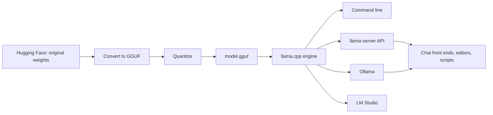

# Running models locally

How to run open-weight language models on your own computer: what hardware you need, which software to use, which model and file to download, and how to make it fast.

## The short route

1. **Find out how much fast memory you have.** On a PC with a graphics card, that is its VRAM. On a Mac or a shared-memory mini PC, it is most of the system memory. See [[local/hardware|Hardware and memory]].
2. **Install a runtime.** [[local/ollama|Ollama]] is the easiest. [[local/llama-cpp|llama.cpp]] gives the most control. [[local/other-tools|LM Studio]] has the friendliest window.
3. **Pick a model that fits** with a few gigabytes to spare, at about 4.5 to 5 bits per weight (a `Q4_K_M` [[local/gguf|GGUF]] file). See [[local/choosing-a-model|Choosing a model]].
4. **Set the context length** you actually need, and check that the whole model is on the graphics card. See [[local/performance|Performance tuning]].

## Pages

| Page | What it covers |
| --- | --- |
| [[local/why-local\|Why run models locally]] | Privacy, cost, control, and where cloud models are still better |
| [[local/hardware\|Hardware and memory]] | Memory size, memory bandwidth, the speed formula, and a calculator |
| [[local/gguf\|GGUF]] | The file format most local tools use, and how to read a file name |
| [[local/llama-cpp\|llama.cpp]] | The engine under most local tools: installing, running and serving |
| [[local/ollama\|Ollama]] | The one-command way to download and run models |
| [[local/other-tools\|Other tools]] | LM Studio, MLX, vLLM, ExLlama, KoboldCpp, Open WebUI and more |
| [[local/choosing-a-model\|Choosing a model]] | Families, sizes, licences, and the 2026 landscape |
| [[local/performance\|Performance tuning]] | Offloading, flash attention, batch sizes, speculative decoding |
| [[local/serving\|Serving models]] | APIs, many users at once, and running a model for a team |

## How the pieces fit

Most people never convert or quantize anything: they download a ready-made GGUF file that someone else has prepared, or let Ollama do it.
