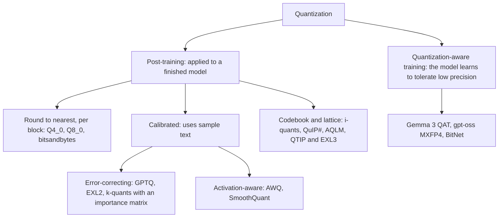

# Quantization

Quantization stores a model's weights (and sometimes its activations and KV cache) in fewer bits, so that it takes less memory and runs faster, at the cost of a small, measurable loss of quality.

## Why it matters so much locally

Generation speed is set by how many bytes are read per token (see [[local/hardware|Hardware and memory]]). Halving the bits halves the bytes, so a 4-bit model is not only four times smaller than a 16-bit one, it is up to about three to four times faster to generate with. And it decides what fits at all: a 70B model is 140 GB at 16 bits and about 42 GB at 4.8 bits.

| Bits per weight | 8B model | 32B model | 70B model |
| --- | --- | --- | --- |
| 16 (bf16, the original) | 16 GB | 64 GB | 140 GB |
| 8.5 (Q8_0) | 8.5 GB | 34 GB | 74 GB |
| 4.9 (Q4_K_M) | 4.9 GB | 20 GB | 43 GB |
| 3.1 (IQ3_XXS) | 3.1 GB | 12 GB | 27 GB |

## Pages

| Page | What it covers |
| --- | --- |
| [[quantization/number-formats\|Number formats]] | fp32, fp16, bf16, fp8, int8, int4, NF4 and FP4: what the bits mean |
| [[quantization/how-it-works\|How quantization works]] | Scales, zero points, groups, rounding and outliers |
| [[quantization/int8\|8-bit quantization]] | LLM.int8(), SmoothQuant and why 8 bits is nearly free |
| [[quantization/gptq\|GPTQ]] | Quantizing column by column and correcting the error as you go |
| [[quantization/awq\|AWQ]] | Protecting the weights that matter by watching activations |
| [[quantization/k-quants\|k-quants and i-quants]] | llama.cpp's GGUF types, the importance matrix, and what Q4_K_M means |
| [[quantization/other-methods\|Other methods]] | NF4, HQQ, EXL2 and EXL3, QuIP#, AQLM, MXFP4, BitNet and quantization-aware training |
| [[quantization/kv-cache\|Quantizing the KV cache]] | Shrinking the memory that grows with context |
| [[quantization/measuring-quality\|Measuring quality]] | Perplexity, KL divergence and benchmarks |
| [[quantization/choosing\|Choosing a quantization]] | Which file to download, in one table |

## Two families of method

Almost everything you download is post-training quantization. It takes minutes to hours on one machine, while quantization-aware training needs the original training setup.
