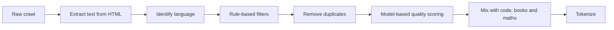

# Training data

Pretraining data is mostly filtered web text, with books, code, academic papers and, increasingly, synthetic text written by other models, and the filtering matters as much as the quantity.

## Where it comes from

- **Web crawls,** mostly derived from Common Crawl, a public archive of billions of web pages. Raw crawl text is overwhelmingly boilerplate, spam and duplicates.
- **Code** from public repositories, filtered by licence and quality.
- **Books, papers and reference works,** where licences allow.
- **Maths and science** text, often specially extracted to keep equations intact.
- **Multilingual text,** weighted up to improve non-English ability.
- **Synthetic data:** textbook-style explanations, exercises and reformulated web pages written by earlier models. Microsoft's Phi models popularised this in 2023 and it is now common.

Open datasets that document their pipelines include The Pile (2020), RedPajama (2023), Dolma (2023), FineWeb and FineWeb-Edu (2024) and DCLM (2024).

## The pipeline

- **Rule-based filters** drop pages with too little text, too many symbols, repeated lines or blocklisted words.
- **Deduplication** removes exact and near-duplicate documents (using techniques such as MinHash). Duplicated text is memorized more and wastes compute.
- **Quality classifiers** are small models trained to tell "educational" or "reference-like" text from the rest. FineWeb-Edu showed that keeping only text a classifier scores as educational gives better models from fewer tokens.
- **Decontamination** removes benchmark questions from the data so that test scores mean something. It is imperfect. See [[training/evaluation|Evaluation]].

## The mix

The proportions matter. More code tends to help reasoning in general, not just coding. More maths helps maths. Labs tune the mix with small-scale experiments and change it during training, ending on the cleanest data.

## Questions that are still open

- **Copyright and consent.** Several lawsuits over training on copyrighted text were in progress through 2025 and 2026. This wiki does not try to summarise their status.
- **Running out of text.** Estimates suggest the stock of good human-written public text is being used up, which is one reason synthetic data and [[training/reasoning|reinforcement learning]] have become more important.
- **Model collapse.** Training repeatedly on a model's own output can narrow its distribution. Careful mixing with real data appears to avoid most of the effect.

## See also

- [[training/fine-tuning|Fine-tuning]], next on the reading path
- [[fundamentals/tokens|Tokens and tokenizers]]
