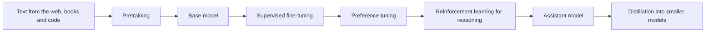

# Training

How a model's weights are set: first by predicting trillions of tokens of text, then by teaching it to follow instructions, prefer good answers and reason, and finally by measuring the result.

Not every model goes through every step, and the order varies. But this is the broad shape of how open-weight assistants were built from 2023 to 2026.

## Pages

| Page | What it covers |
| --- | --- |
| [[training/pretraining\|Pretraining]] | The loss, the optimizer, the hardware, and what a training run costs |
| [[training/data\|Training data]] | Where the trillions of tokens come from and how they are filtered |
| [[training/fine-tuning\|Fine-tuning]] | Supervised fine-tuning on examples, and fine-tuning a model yourself |
| [[training/lora\|LoRA and QLoRA]] | Fine-tuning by training a small add-on instead of the whole model |
| [[training/preference-tuning\|Preference tuning]] | RLHF, reward models, DPO and their relatives |
| [[training/reasoning\|Reasoning models]] | Reinforcement learning on problems with checkable answers, and thinking before answering |
| [[training/distillation\|Distillation]] | Teaching a small model from a large one |
| [[training/evaluation\|Evaluation]] | Benchmarks, their problems, and how to test a model for your own use |

## What you can do at home

Training a useful model from scratch is out of reach of home hardware. Fine-tuning is not: with [[training/lora|LoRA]] and a 4-bit base model, a single 24 GB graphics card can fine-tune models up to about 30B parameters on your own data, and small models fit on much less.
